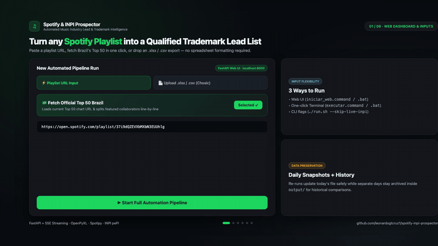

# Spotify & INPI Lead Prospector

Automated music industry **artist enrichment** and **trademark prospection** pipeline built with **Python**, **FastAPI**, **Server-Sent Events (SSE)**, and **OpenPyXL** — turning any Spotify playlist or Chosic chart export into a publication-ready **4-sheet Excel workbook**.


[](media/spotify-inpi-demo-en.mp4)

<p align="center">
  <a href="media/spotify-inpi-demo-en.mp4">▶ Watch full 1080p @ 30fps MP4 demo</a>
</p>

---

## Key Capabilities

### 1. Real-Time FastAPI Dashboard + Live SSE Streaming
- Paste any **Spotify playlist link**, click **Official Top 50 Brazil** in one tap, or upload a **Chosic `.xlsx` / `.csv` chart file**.
- Streams live enrichment steps, track progress, and raw execution logs directly to the browser over **Server-Sent Events** (`/api/jobs/run-stream` and `/api/jobs/{job_id}/stream`).
- Built-in **Spreadsheet History** drawer (`/api/history`) to re-download any prior run.

### 2. Multi-Platform Artist Enrichment
- **Spotify Public & API Support:** Pulls monthly listeners formatted cleanly, splits featured collaborations (`feat.`, `ft.`, `&`, `,`) line-by-line, and reads declared bio links via public artist scraping or optional **Spotipy** developer credentials.
- **YouTube Channel Discovery:** Searches official channels automatically, resolving `@handle` URLs and subscriber totals.
- **TikTok & Instagram Matching:** Extracts Instagram handles and probes matching TikTok profiles for real-time follower counts.

### 3. INPI Trademark Prospection (`busca.inpi.gov.br/pePI`) + Continuous Memory
- **Three-Layer Trademark Resolution:**
  1. **Historical Workbook Cache:** Scans prior `.xlsx` files in both root and `output/` using accent-normalized matching (`NFKD`), reusing verified trademark statuses and manual social overrides with zero rework.
  2. **Live pePI Consultation:** Queries Brazil's National Institute of Industrial Property (INPI) registry for new artists, capturing application numbers, filing priority, Nice classes, owners, and status.
  3. **Smart 1-Click Fallback Links:** Always inserts pre-configured clickable INPI search links for rapid legal review (and supports `--skip-live-inpi` for offline/fast runs).

### 4. Publication-Ready 4-Sheet Excel Output (`openpyxl`)
| Sheet | Purpose |
| --- | --- |
| **`Top 50 - [Playlist]`** | Complete track list with featured artists expanded line-by-line (`Song`, `Artist`, `Genres`, `Album`, `Track ID`, `ISRC`). |
| **`Todos os artistas`** | Deduplicated A–Z directory with track counts, monthly listeners, clickable social links, and full INPI status metadata. |
| **`Artistas sem marca`** | Dedicated prospecting sheet isolating **unregistered artists** as high-priority legal/IP outreach leads. |
| **`Artistas com marca`** | Registered trademark processes with clickable deep links straight to the official INPI record. |

---

## Project Structure

```text
├── web_server.py               # FastAPI server, background ThreadPool pipeline, SSE & history API
├── automator.py                # Interactive CLI runner (playlist URL or local chart file)
├── gerar_planilha_top50.py     # Core CLI enrichment + workbook orchestration
├── modules/
│   ├── spotify_service.py      # Playlist parser & Spotify public/API listener + bio extractor
│   ├── social_service.py       # Instagram, YouTube & TikTok discovery + follower formatters
│   ├── inpi_service.py         # Historical Excel cache loader + live INPI pePI lookup & links
│   └── excel_builder.py        # 4-sheet styled OpenPyXL generator with hyperlinks & auto-widths
├── web/                        # Dark-mode dashboard frontend (HTML, CSS, vanilla JS + SSE)
├── api/index.py & vercel.json  # Vercel Python ASGI deployment adapter
├── run.sh                      # Shell runner supporting --skip-live-inpi
├── iniciar_web.command / .bat  # Double-click Web UI launchers for macOS & Windows
└── executar.command / .bat     # Double-click terminal launchers for macOS & Windows
```

---

## Getting Started

### Requirements
- **Python 3.10+**
- Dependencies listed in [`requirements.txt`](requirements.txt): `openpyxl`, `requests`, `spotipy`, `spotifyscraper`, `fastapi`, `uvicorn`, `python-multipart`

### 1. Install Dependencies & Launch the Web Dashboard

```bash
git clone https://github.com/leonardogtcruz1/spotify-inpi-prospector.git
cd spotify-inpi-prospector
python3 -m venv .venv
source .venv/bin/activate
pip install -r requirements.txt
uvicorn web_server:app --host 127.0.0.1 --port 8000
```

Then open **`http://127.0.0.1:8000`** in your browser (or double-click `iniciar_web.command` on macOS / `iniciar_web.bat` on Windows).

### 2. Run via CLI

```bash
./run.sh
# Or skip live INPI scraping and rely on cache + 1-click links:
./run.sh --skip-live-inpi
```

### 3. Optional Spotify Developer Keys
To also fetch curated official Spotify charts directly by playlist URL via the API, provide `SPOTIPY_CLIENT_ID` and `SPOTIPY_CLIENT_SECRET` (or save `spotify_config.json` from the UI Settings modal).

---

## Author

**Leonardo Cruz** — [GitHub](https://github.com/leonardogtcruz1)
